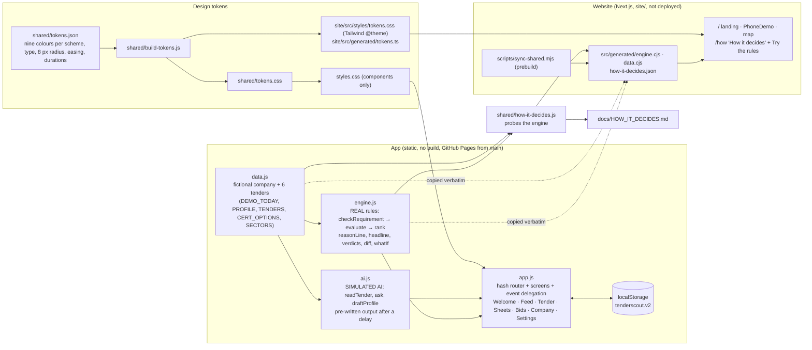

# TenderScout architecture

How the prototype is built: what decides, what is simulated, what is real and what is fictional, how a URL becomes a screen, where state lives, how the website shares the same code, and how it is tested, deployed and rolled back. It describes `main` as of 5 Nov 2026 and adds no new facts: each statement is something a file states or a gate checks.

| This file covers | Not in this file (look here instead) |
|---|---|
| The runtime and its data flow, routing, state, URL parameters, design tokens, the website's shared code, the gates, deploy and rollback, what is real and what is fictional (§9) | What the product is, for whom, and its scope: [`PRODUCT.md`](PRODUCT.md) · the decision rules in full (generated from the code): [`docs/HOW_IT_DECIDES.md`](docs/HOW_IT_DECIDES.md) · screens, flows and states: [`docs/NAVIGATION.md`](docs/NAVIGATION.md) · the build rules (§4–§7) and every decision with its reason (§11): [`CLAUDE.md`](CLAUDE.md) · visuals: [`DESIGN.md`](DESIGN.md) · running it and the teammate tasks: [`docs/START_HERE.md`](docs/START_HERE.md) |



## 1. Runtime: four scripts, one direction

The app at the repository root is five classic scripts loaded in order by `index.html` (`engine.js → data.js → ai.js → insights.js → app.js`; `insights.js` since 5 Nov, the win/loss arithmetic), two stylesheets (`shared/tokens.css`, then `styles.css`) and vendored fonts. There is no bundler and no dependency, so the same files run from GitHub Pages, from `python3 -m http.server` and from `file://`. The scripts are ES5 throughout (no arrow functions, no optional chaining), which keeps older Safari in reach.

- **`data.js`** holds the fictional demo: the company profile, six tenders with their requirements (each with the original sentence, its translation, the page and a confidence), the "AI" summaries and Q&A, the certificate options and the 45 CPV divisions. Every buyer and the company name carry "(fictional)". The demo date is fixed at `2026-11-05` so days left never drift. Display-only fields (`doc`, `highlight`, `photo`) are ignored by the engine.
- **`engine.js`** is the only code that decides. `checkRequirement()` gives each requirement a status (`pass`, `risk`, `fail`, `review`), `evaluate()` adds the four score parts (sector 40, size 20, requirements 30, time 10) and applies the verdict rules (closed, No-go with a cap of 25, Go from 70 with no open line and at most one risk, Maybe otherwise), `rank()` orders the feed. The functions added later (`reasonLine`, `headline`, `verdicts`, `diff`, `whatIf`) are pure functions on top of `evaluate()`, whose return shape is locked by a test. It is deterministic, written as UMD (`window.Engine` in the browser, `module.exports` in node) and runs unchanged in node, in the browser and inside the website.
- **`ai.js`** stands in for the language model: the three jobs that would need one (`readTender`, `ask`, `draftProfile`) return pre-written output from `data.js` after a short delay, with `simulated: true` so the UI can label it. `?demo=fast` shortens the delays. Nothing calls a model; there are no keys.
- **`app.js`** renders the screens from the engine's results, routes on the URL hash and stores state. It never computes a verdict itself. Interactive elements carry `data-*` attributes (`data-go`, `data-act`, `data-filter`, `data-confirm`, `data-ask`, `data-skip`, `data-stage`, `data-unskip`, `data-cert`, `data-lang`, `data-ref`; `data-field` for the turnover input; `data-stop` marks the inside of a sheet so a tap there does not close it), and one delegated click handler dispatches on them, with delegated `change`, `submit` and `keydown` handlers beside it.

The split is the product's honesty claim: the AI reads, the rules decide ([`PRODUCT.md`](PRODUCT.md) §6). `tests/data-check.js` asserts that the "Simulated AI" and fictional-data labels are still rendered. Which data is real and which is fictional: [§9](#9-what-is-real-and-what-is-fictional).

## 2. Routing: from a hash to a screen

`parse()` turns `location.hash` into `{ name, id, sub }`; `render()` guards onboarding, picks the screen function, writes it into `#screen` and shows the tab bar only on Feed, Bids, Company and Settings; `syncSheet()` opens or closes the one sheet layer. Routes, the screens they show and the flows between them are specified in [`docs/NAVIGATION.md`](docs/NAVIGATION.md); this table is where each lives in the code.

| Route | `parse()` → | Rendered by (`app.js`) | Calls |
|---|---|---|---|
| `#/welcome/1`, `/2`, `/3` | `onb`, step | `welcome()`, `readingScreen()`, `checkProfile()` | step 2 runs `startDraft()` → `AI.draftProfile` and is replaced in history (`location.replace`) |
| `#/feed` | `feed` | `feed()`, `card()` | `Engine.rank` |
| `#/t/:id` | `detail` | `detail()`; `loadingDetail()` on the first open per session | `AI.readTender`, `Engine.evaluate`, `Engine.headline`; Ask this tender → `AI.ask` |
| `#/t/:id/req/:rid` | `detail` + `sub: req` | `detail()` underneath, `reqSheet()` in the sheet layer | the owner's answer → `overrides`, then a re-render |
| `#/t/:id/skip` | `detail` + `sub: skip` | `skipSheet()` | `skipConfirm()` → `skipped`, back to the Feed |
| `#/bids` | `bids` | `bids()`, `bidCard()`, `insightsLink()` | `Engine.evaluate`, `Insights.summary` |
| `#/insights` | `insights` | `insightsScreen()` | `Insights.summary` (no engine call) |
| `#/company` | `company` | `company()`, `rescoreCard()`, `hints()` | every lever → `applyLever()` → `Engine.verdicts` + `Engine.diff`; hints → `Engine.whatIf` |
| `#/settings`, `#/about` | `settings` | `settings()` | Reset writes a fresh state |
| anything else | `notfound` | `notFound()` | |

- **Onboarding guard:** until `onboarded` is true, every route except Welcome, Company and Settings (or `#/about`) is replaced by `#/welcome/1`.
- **Sheets are history entries.** In-app Back, closing a sheet and Skip go *back* through a small stack (`backTo()`) instead of stacking new entries; Escape and the scrim close a sheet to its parent tender; while a sheet is open the screen and the tab bar are `inert`.
- **Re-renders are cheap and local:** a lever on Company re-scores all six tenders in the engine and re-renders the screen; same-screen re-renders do not replay entrances. The card → tender morph uses the View Transitions API when the browser has it and a plain hash change otherwise.

## 3. State

One `localStorage` key, **`tenderscout.v2`**: `{ onboarded, profile, website, overrides, saved, skipped, filter, theme, palette }`. `overrides[tenderId][reqId]` is the owner's answer on a line (`pass` | `fail`), `saved[id]` the bid stage, `skipped[id] = { reasons, at }`. `theme` is `dark` (default), `light` or `system`; `palette` is written for shape stability and no longer read. Every read and write is wrapped in try/catch with an in-memory fallback for private mode; the inline script in `index.html` reads the same key before the first paint so the scheme never flashes. If the shape ever changes, the key is bumped (v1 → v2 happened on 2 Nov), not migrated. Session-only state (which tenders were "read", open answers, the last re-score) lives in variables and is gone on reload.

## 4. URL parameters (demo and test only)

| Parameter | Effect |
|---|---|
| `?demo=reset` | writes a fresh `tenderscout.v2`, removes `reset` from the address, lands on `#/welcome/1` |
| `?demo=fast` (or `reset,fast`) | caps the two simulated AI waits at about 300 ms; nothing else changes |
| `?theme=system\|light\|dark` | sets Appearance, persisted |
| `?today=YYYY-MM-DD` | moves the demo date (shows the Closed state); tests only |
| `?offline=1` | shows the offline note; tests only |

The live demo opens `https://pioche8.github.io/ESCP-2627DT-C1/?demo=reset,fast` ([`BRIEF.md`](BRIEF.md)).

## 5. Design tokens: one source, two products

`shared/tokens.json` is the only place colours, type, the one 8 px radius, easing and durations are written: nine solid colours per scheme (background, surface, ink, muted, brand and the four verdict colours), one typeface. `node shared/build-tokens.js` emits `shared/tokens.css` for the app, `site/src/styles/tokens.css` (a Tailwind v4 `@theme` block) and `site/src/generated/tokens.ts` for the website. `styles.css` contains components only and no hand-typed colour. `node shared/check-contrast.js` audits every text/background pair in both schemes against WCAG AA; `tests/declutter-scan.js` proves the absence of the eighteen banned patterns (gradients, shadows, borders, pills, uppercase, italics, mono, eyebrows, numbering, code names in visible text, …) both in the stylesheets and in every rendered screen. Verdicts are never colour alone: shape + word everywhere (● Go, ▲ Maybe, ■ No-go, ◆ Needs your check).

## 6. The website shares the code

`site/` is a Next.js 16 site, not deployed yet (README → Website). `scripts/sync-shared.mjs`, run by `prebuild`, copies `engine.js` and `data.js` verbatim into `site/src/generated/` as CommonJS, rebuilds the tokens, runs `shared/how-it-decides.js` and re-renders the Open Graph image and icons from the tokens. The landing page's phone demo, the tender cards, the counts and the map all call the real engine on the real demo data, so every number on the site is the app's. `/how` ("How it decides") renders `how-it-decides.json`, which the generator produces by *probing* the engine (running it on controlled inputs and reading the constants back), and its "Try the rules" block runs the engine in the browser. `docs/HOW_IT_DECIDES.md` is the same generator's second output. CI fails if either falls behind the code. On Vercel the committed copies are used, so the site builds on its own (Root Directory = `site`).

## 7. Tests and gates

| Gate | What it proves | Where it runs |
|---|---|---|
| `tests/engine.test.js` (24) | the rules of CLAUDE.md §4, the added functions, the locked return shapes | node, `tests.html` in Chromium, CI `check` |
| `tests/data-check.js` | `data.js` has every field the engine and the UI read, unique ids, ISO dates, citations inside their documents, no placeholder text, the honesty labels rendered | node, CI `check` |
| `tests/demo-golden.test.js` | the live demo's numbers (Hohenau 25 → 90 → 100, 1 Go · 2 Maybe · 3 No-go, 777 pages in 4 languages), the storage key, the reset | node, `tests.html`, CI `check` |
| `tests/engine-invariants.test.js` | a seeded property test: a fail is always No-go, score within 0–100, meeting one more line never lowers the score, verdicts consistent with the score, rank sorted | node, CI `check` |
| `tests/docs-check.js` | every route `parse()` accepts and every tab appear in `docs/NAVIGATION.md` and `SKELETON.md`; every check a user story or flow names exists word for word; no interview is cited and no participant is quoted in `docs/design/` unless `evidence.md` logs it | node, CI `check` |
| `tests/declutter-scan.js` | the eighteen patterns are absent from the five stylesheets | node, CI `check` |
| `shared/check-contrast.js` | WCAG AA on every pair, both schemes | node, CI `check` |
| generated files in sync | tokens and the decision model match their sources | CI `check` |
| `tests/smoke.js` | the full click-through at 390×844 (and the iPhone 13 / SE profiles) in dark, light and reduced motion, with the declutter scan on every screen | Playwright + Chromium; CI `smoke` (390×844) |
| `tests/browser-tests.js` | `tests.html` over `file://` and HTTP with 0 page errors | Playwright; CI `smoke` |
| `cd site && npm run check` / `npm run audit` | lint, typecheck, build; static export, the `/how` page check, Lighthouse ≥ 95 (median of 3) and axe 0 violations on both pages in dark and light | local |

`npm run preflight` runs every gate in order and prints one line per gate with the command to rerun it (`--quick` = the node-only set). The workflow `.github/workflows/check.yml` has two jobs, `check` (node only, under a minute, every push) and `smoke` (Chromium, about three minutes, pull requests and pushes to `main`). WebKit cannot be installed in the build containers, so the iPhone profiles are Chromium emulation and Safari items are inspection.

Not on `main` yet: three open pull requests add to this page when merged: an error fallback screen with its smoke pass ([C1](https://github.com/pioche8/ESCP-2627DT-C1/pull/3)), a seeded monkey walk behind `MONKEY=1` ([C2](https://github.com/pioche8/ESCP-2627DT-C1/pull/5)) and home-screen install ([C3](https://github.com/pioche8/ESCP-2627DT-C1/pull/4)).

## 8. Deploy and rollback

GitHub Pages serves `main` at the repository root (`.nojekyll` keeps Jekyll off), at `https://pioche8.github.io/ESCP-2627DT-C1/`; a push to `main` is live after the "pages build and deployment" run, typically within about 18 minutes. `node tests/live-check.js` compares the served files with a checkout byte for byte, and `SMOKE_URL=https://pioche8.github.io/ESCP-2627DT-C1/ node tests/smoke.js` runs the click-through against the live URL (both from a laptop: the build containers cannot reach github.io). The website is not deployed; `STATIC_EXPORT=1 npm run build` in `site/` gives a static preview.

The workshop build is frozen on the branch **`release/v1-workshop`** (tag pushes are blocked from the build sessions). Rollback in one command, from any machine with push rights:

```
git push --force-with-lease origin release/v1-workshop:main
```

Older rollback points are the `backup/*` branches. Changes reach `main` through pull requests with CI green. The ruleset that enforces it (pull request required, `check` and `smoke` required, no force push, admin bypass so the rollback still works) is committed as `.github/ruleset-main.json`; a build session cannot apply it ([`CLAUDE.md`](CLAUDE.md) §11 item 92), so until someone has applied it from a laptop (Settings → Rules → Rulesets shows it) this is a team convention, not a lock.

## 9. What is real and what is fictional

The code is real, the demo data it runs on is fictional, and the only real user data so far is one survey answer. Every number, name and example in this repository's documents is one of five kinds:

| Kind | What | Details in | Evidence about users? |
|---|---|---|---|
| **Real: user data** | Survey response S1 (one respondent, self-reported); no interviews yet | [`evidence.md` §1b](evidence.md#1b-survey-responses-screening-form-not-interviews) | Yes, as signals only, outside the gate |
| **Real: desk research** | The European Court of Auditors' figures on EU procurement, the competitors, the 45 CPV divisions | [`evidence.md` §5](evidence.md#5-desk-research-separate-from-interview-evidence) (sources and access dates) | Context only. The smaller competitors and "eForms mandatory on TED since Oct 2023" in [`BRIEF.md`](BRIEF.md) have no source in §5 yet |
| **Real: code and measurements** | The rules, score and verdicts, the screens, the test results | §1 and §7 above | It proves how the prototype behaves, not that anyone needs it. The weights and thresholds are design choices, not set by evidence |
| **Fictional** | The company, the six tenders and their buyers, every quote, translation, page number, confidence value and AI answer, and so every demo number the engine computes from them (Hohenau 25 → 90 → 100, 777 pages); the website's weekly sector counts | `data.js`, `site/src/data/sectors.ts` | No. The app marks it "(fictional)", "All companies and tenders are fictional" and "Simulated AI"; the website says "illustrative" |
| **ASSUMPTION** | The metric targets, prices, bid cost and screening time | [`BRIEF.md`](BRIEF.md) | No. These are what the interviews have to test |

**The rule:** fictional data may show how the product behaves, never that users need it.
