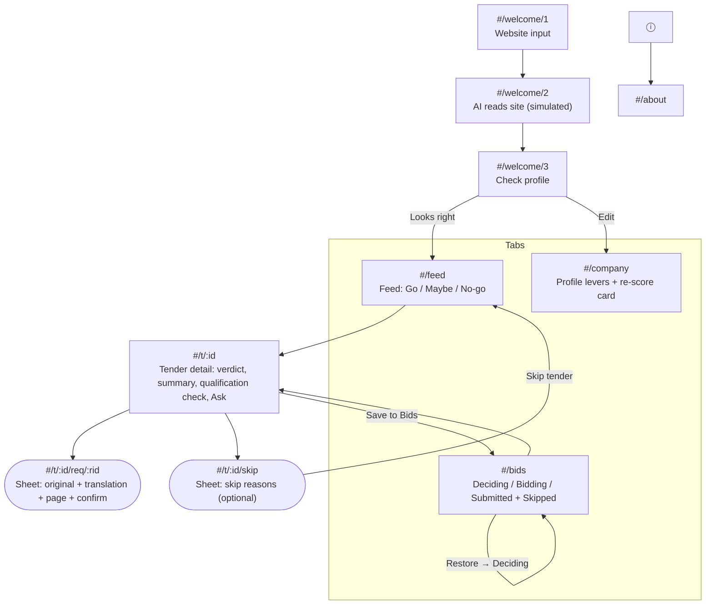

# Navigation map and user flows

Context of use: an owner on a phone, between jobs, often in a van or on site. **One hand, short sessions (1–3 min), patchy signal.** So: a bottom tab bar within thumb reach, one primary action per screen in a bottom bar, every verdict readable in under 3 seconds (shape + label + colour), and no typing in the core loop.

> Updated 2 Nov 2026 for the DESIGN.md "Bold" restyle, and 3 Nov 2026 for the design handoff v2 (`design/HANDOFF_V2.md`: Sky and Harbor palettes, photography, Welcome v2, entrances). Routes and deep links are unchanged; what changed is marked **(new)** or **(v2)**.
>
> 3 Nov 2026 (vibe pass): routes, deep links and back behaviour unchanged. The dock is now one element with a pill that slides between Feed, Bids and Company (the website's PhoneDemo dock); the app opens dark by default (About: System / Light / Dark, or `?theme=`); summary counts are a compact row on glass instead of three big tiles (tap still filters); the tender header is dark glass with the score in the verdict colour.
>
> 4 Nov 2026 (declutter): routes, deep links and back behaviour unchanged. The floating dock is a standard full-width bottom tab bar (icon + label; the active tab is brand-coloured with a filled icon and a bolder label). The Feed's summary counts live in the filter tabs ("All 6 · ● Go 1 · ▲ Maybe 2 · ■ No-go 3", underlined text, no tiles); the stage switcher on Bids and the appearance switch on About are the same text tabs. Cards show verdict (shape + word + score), title, buyer, value and days left only; the tender header is plain text on the ground with the photo in its own block beneath it; the detail's facts are value and deadline. Statuses, "Simulated AI" and citations ("Vergabeunterlagen, p. 12, §3.1") are plain text. Bid languages on Company are rows with switches; skip reasons are plain toggle buttons. There is one palette (About keeps System / Light / Dark); `?palette=` is ignored.

## Structure
Three tabs, three questions the owner asks:
| Tab | Question | Route |
|---|---|---|
| **Feed** | "Anything worth bidding on today?" | `#/feed` |
| **Bids** | "What am I working on, what did I skip?" | `#/bids` |
| **Company** | "What do you think we can do?" | `#/company` |

The tabs live in a full-width bottom tab bar. **The tab bar is hidden during onboarding, on a tender detail and on About**, so those screens keep their bottom action bar in the thumb zone. About (AI disclosure, appearance and demo reset) opens from the ⓘ in the Feed, Bids and Company headers and on Welcome.

## Screen list
| # | Route | Screen | Primary action | Notes |
|---|---|---|---|---|
| S1 | `#/welcome/1` | Welcome + website | Draft my profile | Photo in its own block, headline, the line "All 45 EU sectors · 6 new tenders tonight" (derived from the data), the website field and the button. (The v2 sector band and preview card were removed in the 4 Nov declutter.) Only typed input in the core flow is here |
| S2 | `#/welcome/2` | Reading (transient) | none | Step list and progress bar **(new)**; replaced in history, not a back target |
| S3 | `#/welcome/3` | Check profile | Looks right | "Edit" goes to S6 |
| S4 | `#/feed` | Feed | Open a tender | Summary tiles (tap = filter) and filter All/Go/Maybe/No-go with counts; skipped hidden; saved = bookmark on the card. **(v2)** Cards carry a 96 px photo band with the score tile overlapping it; tenders without a photo show a document placeholder. Tapping a card morphs it into the detail header where the browser supports view transitions |
| S5 | `#/t/:id` | Tender detail | Save to Bids | First open per session shows "Reading N pages (lang)…" with progress **(new)**. **(v2)** The verdict header multiplies the tender photo (grayscale) over the verdict colour. Requirements sorted fail → check → risk → met |
| S5a | `#/t/:id/req/:rid` | Requirement sheet | We meet it / We don't meet it | Own history entry. Shows status, AI confidence, quote card with the decisive phrase marked, translation |
| S5b | `#/t/:id/skip` | Skip sheet | Skip tender | Pick any number of reasons, or none **(new)**. Feeds tomorrow's ranking (future) |
| S6 | `#/company` | Company profile | (live) | Re-score card "Landkreis Hohenau · No-go → Go" and unlock hints such as "Turn on → Gemeente Vlietdam becomes Maybe" **(new)**. **(v2)** Photo behind the top of the header |
| S7 | `#/bids` | Bids pipeline | Change stage | Empty groups show "Nothing here yet". **Restore moves a skipped tender to Deciding (new)**. **(v2)** 48 px photo thumbnail on each bid card |
| S8 | `#/about` | About / AI disclosure | Reset demo | Reset asks to confirm **(new)**. Appearance: System / Light / Dark **(new)**, persisted (the palette switch was removed on 4 Nov). `?demo=reset` does the same reset |
| – | anything else | Not found | Open Feed | |

**Later (not in prototype):** push notification each morning → deep link `#/t/:id`; consortium-partner finder; calendar export of deadlines and site visits; share a verdict to a colleague by WhatsApp; opening the tender PDF at the cited page (today the citation chip opens the requirement sheet).

## Core flows
**Flow 1: Morning triage (target under 60 s)**
Push / open app → Feed (counts at top) → tap the Go card → scan the qualification check (all ● Meets) → Save to Bids. The button turns into "In Bids · Deciding" and a toast offers "View".

**Flow 2: Resolve an unclear line**
Detail → the ◆ "Needs your check" line sorts right after any fails → tap → sheet shows the original sentence, translation and page → "We meet it" → the sheet closes, the verdict recalculates, and a toast says "Answer saved · now …" with Undo.

**Flow 3: Learn what's blocking you**
Detail shows ■ "ISO 27001 mandatory" → Company tab → the hint under ISO 27001 says what turning it on would do → toggle → the re-score card shows "Landkreis Hohenau · No-go → Go" and the tiles re-flex. The hint is honest: if the "comparable qualification" line is still unanswered, it says Hohenau only becomes **Maybe**, and the re-score card shows No-go → Maybe. On the next Feed visit the changed card's score tile pulses once.

**Flow 4: Skip with reasons**
Detail → Skip → pick reasons (optional) → Skip tender → back to the Feed, the card collapses out, and a toast says "Skipped. Reason saved." with Undo. The tender shows under Bids → Skipped with its reasons. Restore puts it in Deciding.

## Deep linking and back behaviour
- Hash routes (`#/…`), because GitHub Pages has no server rewrites. Every screen is linkable.
- Sheets are their own history entries: system Back, Escape, a tap on the scrim, Cancel, or answering all close the sheet to its parent. Closing goes back in history rather than adding a new entry, so Back never reopens a closed sheet.
- ‹ on a detail goes back to the Feed or Bids if you came from there; otherwise (deep link) it opens the Feed.
- Unknown route → "Not found" with a link to the Feed. Before onboarding, any deep link except Welcome, Company and About redirects to Welcome.
- After a screen change, focus moves to the screen title (for screen readers); after a sheet closes, focus returns to what opened it.

## States (DESIGN.md §6)
| State | Where | How to see it in the demo |
|---|---|---|
| Loading tender | Detail, first open per session | Open any tender |
| Closed | Detail and Feed | Test-only URL `?today=2026-12-23` (all deadlines passed). Card dims its score tile and status line; Save is disabled with "Closed tenders can't be saved" |
| Saved | Detail, Feed card, Bids | Save to Bids |
| Skipped | Feed (collapses), Bids → Skipped | Skip a tender |
| Empty feed | Feed | Skip every tender |
| Empty Bids | Bids | Reset the demo, finish onboarding, open Bids |
| Offline | Feed and Detail banner | Turn off the network, or test-only `?offline=1` |

## Edge cases handled
- AI confidence under 70% → shown as ◆ "Needs your check" with the confidence, never counted as a pass, and blocks a Go until you answer it.
- Deadline day or later → "Closed", score 0, Save disabled.
- Storage blocked (private mode) → in-memory state, so the app still works for the session. State key `tenderscout.v2`.
- Dark mode (follows the phone, or About → Appearance) and reduced motion (no animation, same results) respected. Tap targets ≥ 44 px.

## Appearance (4 Nov 2026)
About → Appearance offers System / Light / Dark (`?theme=` is the demo deep link; the choice is persisted in `tenderscout.v2`). The Sky and Harbor palettes of 3 Nov were removed in the declutter: both schemes now use the same nine colours, light and dark. Routes, screens and back behaviour are unchanged.

**Header toggle (4 Nov, evening):** the ◐ button next to ⓘ on Welcome, Feed, Bids and Company switches light ↔ dark in one tap (on the Feed the "Simulated AI" label now sits on the pages line, so the header fits a 320 px phone) (it sets an explicit Light or Dark; About → Appearance is where System is chosen again). Secondary buttons (Skip, Cancel, Edit, Restore, In Bids, the two answers while a line is unresolved) are the muted colour as a solid fill with ground-coloured text in both schemes; the two answer buttons share one width until an answer exists; Reset demo is plain red text in the button frame.
