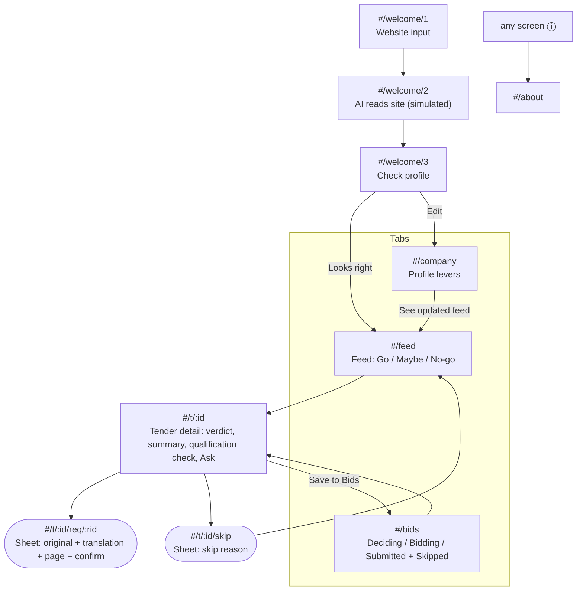

# Navigation map and user flows

Context of use: an owner on a phone, between jobs, often in a van or on site. **One hand, short sessions (1–3 min), patchy signal.** So: bottom tabs within thumb reach, one primary action per screen, every verdict readable in under 3 seconds, and no typing in the core loop.

## Structure
Three tabs, three questions the owner asks:
| Tab | Question | Route |
|---|---|---|
| **Feed** | "Anything worth bidding on today?" | `#/feed` |
| **Bids** | "What am I working on, what did I skip?" | `#/bids` |
| **Company** | "What do you think we can do?" | `#/company` |

About (AI disclosure and demo reset) opens from the ⓘ in the header, not a tab. Tabs are hidden during onboarding.

## Screen list
| # | Route | Screen | Primary action | Notes |
|---|---|---|---|---|
| S1 | `#/welcome/1` | Welcome + website | Draft my profile | Only input in the whole app is here |
| S2 | `#/welcome/2` | Reading (transient) | none | Replaced in history, not a back target |
| S3 | `#/welcome/3` | Check profile | Looks right | "Edit" goes to S6 |
| S4 | `#/feed` | Feed | Open a tender | Filter chips All/Go/Maybe/No-go; skipped hidden |
| S5 | `#/t/:id` | Tender detail | Save to Bids | First open shows "Reading N pages…" |
| S5a | `#/t/:id/req/:rid` | Requirement sheet | We meet it / We don't | Own history entry, so Back closes it |
| S5b | `#/t/:id/skip` | Skip-reason sheet | Pick a reason | Feeds tomorrow's ranking (future) |
| S6 | `#/company` | Company profile | See updated feed | Shows "X: No-go → Go" deltas live |
| S7 | `#/bids` | Bids pipeline | Change stage | Restore skipped |
| S8 | `#/about` | About / AI disclosure | Reset demo | `?demo=reset` does the same |

**Later (not in prototype):** push notification each morning → deep link `#/t/:id`; consortium-partner finder; calendar export of deadlines and site visits; share a verdict to a colleague by WhatsApp.

## Core flows
**Flow 1: Morning triage (target under 60 s)**
Push / open app → Feed (counts at top) → tap the Go card → scan the qualification check (all ✓) → Save to Bids.

**Flow 2: Resolve a Maybe**
Feed → Maybe card → the "?" line sorts to the top → tap → sheet shows the original sentence, translation and page → "We meet it" → verdict recalculates on return.

**Flow 3: Learn what's blocking you**
Detail shows ✕ "Missing ISO 27001" → Company tab → toggle ISO 27001 → green banner "Hohenau: No-go → Go". The owner sees which certificate or partner unlocks which contracts.

**Flow 4: Skip with a reason**
Detail → Skip → reason sheet → back to Feed with a toast. The tender shows under Bids → Skipped, where it can be restored.

## Deep linking and back behaviour
- Hash routes (`#/…`), because GitHub Pages has no server rewrites. Every screen is linkable.
- Sheets are their own history entries: system Back, the ‹ button, Escape or a tap on the scrim all close the sheet to its parent.
- ‹ on a detail goes to the Feed (its parent), not "previous page", so a deep link from a notification still has a sensible Back.
- Unknown route → "Not found" with a link to the Feed. Before onboarding, any deep link redirects to Welcome.

## Edge cases handled
- AI confidence under 70% → shown as "?" (review), never counted as a pass, and blocks a Go.
- Deadline passed → "Closed", score 0, Save disabled.
- Storage blocked (private mode) → in-memory state, so the app still works for the session.
- Dark mode and reduced motion respected. Tap targets ≥ 44 px.
