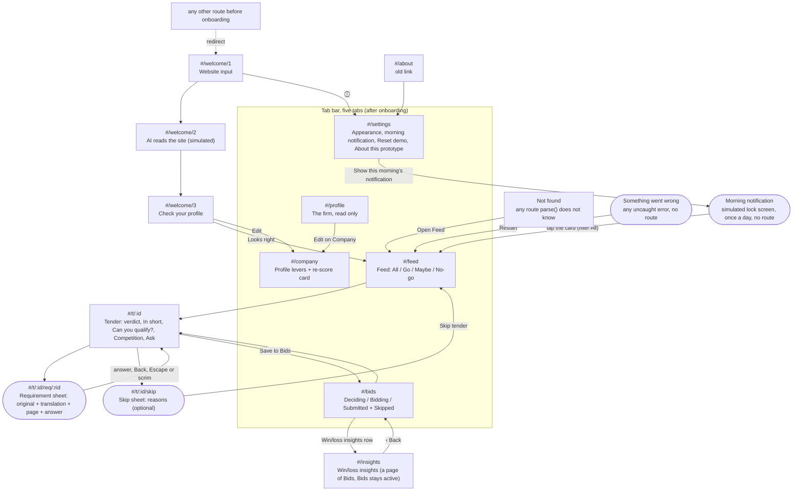

# Navigation map and user flows

Context of use: an owner on a phone, between jobs, often in a van or on site. **One hand, short sessions (1–3 min), patchy signal.** So: a bottom tab bar within thumb reach, one primary action per screen in a bottom bar, every verdict readable in under 3 seconds (shape + label + colour), and no typing in the core loop.

> **Current as of 6 Nov 2026.** The sections from "Structure" down describe `main`: five tabs, the simulated morning notification, the Competition section on a tender, Win/loss insights, the Profile tab, the Settings tab and the error fallback, read from `parse()`, `TABS` and the render functions in `app.js`. The dated notes below are kept as history; where an older note disagrees with a later one or with the sections below, the later text is right. `node tests/docs-check.js` fails when a route `parse()` accepts or a tab in `TABS` is missing from this page, and when a check named here (smoke `…`, engine `…`, golden `…`, insights `…`) does not exist word for word.

> Updated 2 Nov 2026 for the DESIGN.md "Bold" restyle, and 3 Nov 2026 for the design handoff v2 (`design/HANDOFF_V2.md`: Sky and Harbor palettes, photography, Welcome v2, entrances). Routes and deep links are unchanged; what changed is marked **(new)** or **(v2)**.
>
> 3 Nov 2026 (vibe pass): routes, deep links and back behaviour unchanged. The dock is now one element with a pill that slides between Feed, Bids and Company (the website's PhoneDemo dock); the app opens dark by default (About: System / Light / Dark, or `?theme=`); summary counts are a compact row on glass instead of three big tiles (tap still filters); the tender header is dark glass with the score in the verdict colour.
>
> 4 Nov 2026 (declutter): routes, deep links and back behaviour unchanged. The floating dock is a standard full-width bottom tab bar (icon + label; the active tab is brand-coloured with a filled icon and a bolder label). The Feed's summary counts live in the filter tabs ("All 6 · ● Go 1 · ▲ Maybe 2 · ■ No-go 3", underlined text, no tiles); the stage switcher on Bids and the appearance switch on About are the same text tabs. Cards show verdict (shape + word + score), title, buyer, value and days left only; the tender header is plain text on the ground with the photo in its own block beneath it; the detail's facts are value and deadline. Statuses, "Simulated AI" and citations ("Vergabeunterlagen, p. 12, §3.1") are plain text. Bid languages on Company are rows with switches; skip reasons are plain toggle buttons. There is one palette (About keeps System / Light / Dark); `?palette=` is ignored.

> 5 Nov 2026 (Settings tab): About became **Settings**, a fourth tab (`#/settings`, icon `tune`). It holds Appearance (System / Light / Dark), Demo (Reset demo) and "About this prototype" (the four honesty statements, unchanged). `#/about` still works and opens the same tab; the ⓘ in the headers now opens Settings. Everything else is unchanged.

> 5 Nov 2026 (Win/loss insights): Bids gained a **Win/loss insights** page (`#/insights`), opened from the row at the top of Bids. It shows the win rate, the value won, the win rate by area and why bids were lost (for example "6.8% above the winner" on price), computed from the company's past bids (fictional). The tab bar stays, with Bids active; ‹ Back returns to Bids, also after a deep link.

> 5 Nov 2026 (error fallback): an uncaught error or an unhandled rejection replaces the screen with "Something went wrong · Your profile, answers and saved tenders are kept." and one Restart button; Restart reloads the app on the Feed (or Welcome before onboarding). The stored state `tenderscout.v2` is not touched; the error is logged to the console.

> 6 Nov 2026 (this page brought up to date): five tabs (Profile, `#/profile`, was added on 5 Nov in commit `b3f8ec2`); the morning notification (5 Nov, `CLAUDE.md` §11 item 120) moved from "Later" into the flows as an entry point; the Competition section on a tender (5 Nov, commit `4559372`), the Win/loss flow and the Profile flow were added; every flow lists its error and edge branches with the check that proves each, or says that none does; the photo bands, photo thumbnails and bookmark markers that the 4 Nov declutter removed were taken out of the screen list.

## Structure
Five tabs: three questions the owner asks about tenders, one look at the firm, and Settings:
| Tab | Question | Route |
|---|---|---|
| **Feed** | "Anything worth bidding on today?" | `#/feed` |
| **Bids** | "What am I working on, what did I skip, and how do our bids end?" | `#/bids` (Win/loss insights, `#/insights`, is a page of Bids) |
| **Company** | "What would change with another certificate, reference or bid language?" | `#/company` |
| **Profile** | "What does TenderScout think our firm is?" | `#/profile` |
| **Settings** | "How does it look, and what is real here?" | `#/settings` (`#/about` opens the same screen) |

**Profile shows the firm; Company changes it.** Profile is the company profile card, read only, with one button, "Edit on Company". Company holds the levers (turnover, references, certificates, bid languages, bidding abroad) and re-scores every tender when one moves.

The tabs live in a full-width bottom tab bar (icon + label; the active tab is brand-coloured). **The tab bar is hidden during onboarding, on a tender and its sheets, on Not found and on the error screen**, so those screens keep their bottom action bar (or nothing) in the thumb zone. Win/loss insights keeps the tab bar with Bids active. The ⓘ in the Welcome, Feed, Bids, Company and Profile headers opens Settings; before onboarding Settings has no tab bar and shows ‹ Back instead.

## Screen list
| # | Route | Screen | Primary action | Notes |
|---|---|---|---|---|
| S1 | `#/welcome/1` | Welcome + website | Draft my profile | Photo in its own block, headline, the line "All 45 EU sectors · 6 new tenders tonight" (derived from the data), the website field and the button. Only typed input in the core flow is here |
| S2 | `#/welcome/2` | Reading (transient) | none | Step list and progress bar, "Simulated AI"; replaced in history, not a back target |
| S3 | `#/welcome/3` | Check your profile | Looks right | The drafted profile card with its sources; "Edit" goes to S6 |
| S4 | `#/feed` | Feed | Open a tender | The filter tabs All / Go / Maybe / No-go carry the counts; skipped tenders are hidden; a saved tender shows a plain "Saved". Cards show verdict (shape + word + score), title, buyer, value and days left, nothing else (4 Nov declutter). Tapping a card morphs it into the tender's header where the browser supports view transitions |
| S5 | `#/t/:id` | Tender detail | Save to Bids | First open per session shows "Reading N pages (lang)…" with progress. The verdict header is plain text: shape + word, the score in the verdict colour and one sentence of why; the tender's photo, where it has one, is its own block beneath it. Requirements sorted Fails → Needs your check → Risk → Meets. Then **Competition** (5 Nov): likely bidders and similar past awards, labelled "Simulated AI", and a rough chance to win from plain rules ("not AI. It does not change the score."); hidden on a Closed tender. Then Ask this tender, where the tender has questions |
| S5a | `#/t/:id/req/:rid` | Requirement sheet | We meet it / We don't meet it | Own history entry. Shows status, AI confidence, the original sentence with the decisive phrase underlined, the page, and the translation |
| S5b | `#/t/:id/skip` | Skip sheet | Skip tender | Pick any number of reasons, or none. Feeds tomorrow's ranking (future: the reasons are stored, not used yet) |
| S6 | `#/company` | Company | (live) | Re-score card "Landkreis Hohenau · No-go → Go" and unlock hints such as "Turn on → Gemeente Vlietdam becomes Maybe". Before onboarding it has an action bar, "Save and see my feed", instead of the tab bar |
| S6b | `#/profile` | Profile (tab, 5 Nov) | Edit on Company | The company profile card, read only (name, city, staff, turnover, references, sectors, certificates, bid languages, countries): the same card as S3 without the sources line |
| S7 | `#/bids` | Bids pipeline | Change stage | The "Win/loss insights" row at the top (also on an empty Bids), then Deciding / Bidding / Submitted with a stage switch on each card, then Skipped with Restore. Empty groups show "Nothing here yet". Restore moves a skipped tender to Deciding |
| S7b | `#/insights` | Win/loss insights (a page of Bids, 5 Nov) | (read only) | Four figures (win rate, value won, bids lost, % above the winner when lost on price), win rate by area (CPV division, best first) and why bids were lost, from the fictional past bids; plain arithmetic, not AI. Tab bar stays with Bids active; ‹ Back → Bids |
| S8 | `#/settings` (and `#/about`) | Settings (tab since 5 Nov) | Reset demo | Appearance: System / Light / Dark, persisted. Morning notification: "Show this morning’s notification". Demo: Reset demo asks to confirm; `?demo=reset` does the same reset. About this prototype: the four honesty statements |
| S9 | – (overlay, no route) | Morning notification (simulated, 5 Nov) | Tap the notification | A lock screen over the app, once a day: "Simulated notification", the date, 7:00 and one card "TenderScout · now" with ● Go · ▲ Maybe · ■ No-go counts from the engine. Opens the Feed with the filter on All |
| S10 | – (no route) | Error fallback (5 Nov) | Restart | "Something went wrong · Your profile, answers and saved tenders are kept." Restart reloads on the Feed (Welcome before onboarding) |
| – | anything else | Not found | Open Feed | "Page not found · That link matches no screen in TenderScout." |

**Later (not in prototype):** sending the morning notification as a real push to the phone (the prototype shows it inside the app, S9; real push is out of scope, `CLAUDE.md` §10); consortium-partner finder; calendar export of deadlines and site visits; share a verdict to a colleague by WhatsApp; opening the tender PDF at the cited page (today the citation is plain text and the whole requirement line opens the sheet).

## Core flows
**Entry points.** The owner reaches the Feed in one of three ways: the **morning notification** (once a day, the first time the Feed opens on a new day after onboarding; tapping it opens the Feed with the filter on All; ✕, Escape or a tap on the empty lock screen close it and leave the Feed as it was); opening the app (the Feed after onboarding, Welcome before); or a deep link (`#/t/:id` and the other routes, see "Deep linking" below). Proof: smoke `morning notification: first Feed open of a new day shows the simulated lock screen (dialog, "Simulated notification", the date)`, `morning notification: "1 Go · 2 Maybe · 3 No-go" from the engine, each with its shape`, `morning notification: tapping it opens the Feed` and `morning notification: once a day (a reload the same day does not show it again)`. That the filter is set back to All is not locked by a test.

**Branches on any screen** (each flow below can hit these):
- **Error fallback.** Any uncaught error or unhandled rejection shows "Something went wrong" with one Restart button and no tab bar; Restart reloads on the Feed with `tenderscout.v2` intact. Proof: smoke `plain screen with Restart as the only action, no tab bar`, `the error screen stays while the hash changes` and `Restart returns to the Feed with tenderscout.v2 intact (still onboarded, the saved tender still saved)`.
- **Deep link before onboarding.** Any route except Welcome, Company and Settings (or `#/about`) redirects to `#/welcome/1`, unknown routes included. Not locked by a test.
- **Unknown route.** After onboarding, a route `parse()` does not know shows Not found with "Open Feed". Proof: the smoke path loads `#/nope` and waits for "Page not found"; no named check.
- **Offline.** With no network (or the test-only `?offline=1`) the Feed and the tender show "Offline. Showing last night’s results." and keep working on the stored results. Proof: the smoke path loads `?offline=1#/feed` and waits for the banner; no named check.

**Flow 1: Morning triage (target under 60 s)**
Morning notification or open the app → Feed (the counts are the filter tabs) → tap the Go card → scan the qualification check (all ● Meets) → Save to Bids. The button turns into "In Bids · Deciding" and a toast offers "View".
- **Closed tender:** on the deadline day or later a tender is Closed with score 0, its header says "The deadline passed on …", Save is disabled with "Closed tenders can’t be saved" and the Competition section is hidden. Seen with the test-only `?today=2026-12-23`. Proof: engine `past deadline is closed with score 0`, smoke `closed header`, `Save disabled with the lock line` and `closed cards use solid tokens, not opacity`.
- **A filter with no match:** "No Go tenders tonight." with "Show all". Not locked by a test.
- **Empty Feed:** with every tender skipped, "Nothing new tonight" with "Widen your profile" (→ Company). Not locked by a test.

**Flow 2: Resolve an unclear line**
Detail → the ◆ "Needs your check" line sorts right after any fails → tap → sheet shows the original sentence, translation and page → "We meet it" → the sheet closes, the verdict recalculates, and a toast says "Answer saved · now …" with Undo.
- **Leave without answering:** Back, Escape or a tap on the scrim close the sheet to the tender. Proof: smoke `Back closes the sheet to the detail`, `Escape closes the sheet` and `scrim tap closes the sheet`.
- **Change your mind:** Undo in the toast, or "Undo" next to "You answered" on the sheet. Not locked by a test.
- **A link that no longer matches:** an unknown requirement id opens the tender instead; an unknown tender id shows Not found (and its sheet links open the Feed). Not locked by a test.

**Flow 3: Learn what's blocking you**
Detail shows ■ Fails · "ISO 27001 information security" → Company tab (or Profile → "Edit on Company") → the hint under ISO 27001 says what turning it on would do → toggle → the re-score card shows "Landkreis Hohenau · No-go → Go" and the counts count up. The hint is honest: if the "comparable qualification" line is still unanswered, it says Hohenau only becomes **Maybe**, and the re-score card shows No-go → Maybe. On the next Feed visit the changed card's score tile pulses once.
- **ISO 27001 alone:** No-go → Maybe, not Go. Proof: smoke `without the answer the hint says Maybe` and `ISO 27001 alone: re-score card says No-go → Maybe`, golden `ISO 27001 alone moves Hohenau to Maybe 90 (the honest intermediate state)`.
- **Before onboarding:** Company (from "Edit" on Check your profile) has no tab bar and ends with "Save and see my feed". Not locked by a test.

**Flow 4: Skip with reasons**
Detail → Skip → pick reasons (optional) → Skip tender → back to the Feed, the card collapses out, and a toast says "Skipped. Reason saved." with Undo. The tender shows under Bids → Skipped with its reasons. Restore puts it in Deciding.
- **Cancel:** Cancel, Back, Escape or the scrim close the sheet and nothing is skipped. Not locked by a test.
- **Skip everything:** the Feed shows "Nothing new tonight" (Flow 1). Not locked by a test.

**Flow 5: Win/loss insights**
Bids → the "Win/loss insights" row ("8 of 21 won · 38% in the last 12 months") → `#/insights`: the four figures, win rate by area and why bids were lost → ‹ Back → Bids. The tab bar stays with Bids active throughout. Proof: smoke `Bids links to Win/loss insights with the win rate`, `Win/loss keeps Bids active in the tab bar` and `Back from Win/loss returns to Bids`.
- **Deep link:** `#/insights` opened directly still goes ‹ Back to Bids. Proof: smoke `deep link #/insights: Back lands on Bids`.
- **Empty Bids:** with nothing saved or skipped, Bids shows the Win/loss row, then "No bids yet" with "Open Feed". Proof: the smoke path waits for "No bids yet", then smoke `the Win/loss link shows on an empty Bids too (past results are history)`.
- **No past bids:** "No results yet". Not reachable with the demo data; the arithmetic for an empty list is locked by insights `empty input: zeros, no division by zero, nulls where nothing can be computed`.

**Flow 6: Check what TenderScout assumes about the firm**
Profile tab → the profile card (staff, turnover, references, sectors, certificates, bid languages, countries) → "Edit on Company" → Company (Flow 3) → back on Profile the card shows the change. Proof: smoke `five tabs: Feed, Bids, Company, Profile, Settings` and `Profile tab: the company profile and Edit on Company`. That Profile shows a change made on Company is not locked by a test.

## Deep linking and back behaviour
- Hash routes (`#/…`), because GitHub Pages has no server rewrites. Every screen is linkable; the morning notification and the error screen have no route of their own.
- Sheets are their own history entries: system Back, Escape, a tap on the scrim, Cancel, or answering all close the sheet to its parent. Closing goes back in history rather than adding a new entry, so Back never reopens a closed sheet.
- ‹ on a detail goes back to the Feed or Bids if you came from there; otherwise (deep link) it opens the Feed. Proof: smoke `detail ‹ returns to the Feed` (after coming from the Feed) and `deep link #/t/kal-fibre works (Maybe)` (the deep link opens); ‹ after a deep link is not locked by a test.
- ‹ on Win/loss insights goes back to Bids, also after a deep link.
- Unknown route → "Not found" with a link to the Feed. Before onboarding, any deep link except Welcome, Company and Settings (or `#/about`) redirects to Welcome. Proof for the old link: smoke `the old #/about deep link opens the Settings tab`.
- After a screen change, focus moves to the screen title (for screen readers); after a sheet or the morning notification closes, focus returns to what opened it.

## States (DESIGN.md §6)
| State | Where | How to see it in the demo |
|---|---|---|
| Loading tender | Detail, first open per session | Open any tender |
| Closed | Detail and Feed | Test-only URL `?today=2026-12-23` (all deadlines passed). Card dims its score tile and status line; Save is disabled with "Closed tenders can't be saved"; no Competition section |
| Saved | Detail, Feed card ("Saved"), Bids | Save to Bids |
| Skipped | Feed (collapses), Bids → Skipped | Skip a tender |
| Empty feed | Feed | Skip every tender |
| Empty Bids | Bids (the Win/loss row stays) | Reset the demo, finish onboarding, open Bids |
| No past bids | Win/loss insights | Not reachable with the demo data ("No results yet") |
| Offline | Feed and Detail banner | Turn off the network, or test-only `?offline=1` |
| Morning notification | Over the Feed, once a day | `?demo=morning`, or Settings → "Show this morning’s notification" |
| Error | Any screen | Only on an uncaught error; the smoke test injects one |

## Edge cases handled
- AI confidence under 70% → shown as ◆ "Needs your check" with the confidence, never counted as a pass, and blocks a Go until you answer it.
- Deadline day or later → "Closed", score 0, Save disabled.
- Storage blocked (private mode) → in-memory state, so the app still works for the session. State key `tenderscout.v2`.
- Dark mode (follows the phone, or Settings → Appearance) and reduced motion (no animation, same results) respected. Tap targets ≥ 44 px.

## Appearance (4 Nov 2026)
Settings → Appearance (About until 5 Nov) offers System / Light / Dark (`?theme=` is the demo deep link; the choice is persisted in `tenderscout.v2`). The Sky and Harbor palettes of 3 Nov were removed in the declutter: both schemes now use the same nine colours, light and dark. Routes, screens and back behaviour are unchanged.

**Header toggle (4 Nov, evening):** the ◐ button next to ⓘ on Welcome, Feed, Bids and Company (and Profile since 5 Nov) switches light ↔ dark in one tap (on the Feed the "Simulated AI" label now sits on the pages line, so the header fits a 320 px phone) (it sets an explicit Light or Dark; Settings → Appearance is where System is chosen again). Secondary buttons (Skip, Cancel, Edit, Restore, In Bids, the two answers while a line is unresolved) are the muted colour as a solid fill with ground-coloured text in both schemes; the two answer buttons share one width until an answer exists; Reset demo is plain red text in the button frame.

## Morning notification (5 Nov 2026)
Once a day, the first time the Feed opens after the overnight read, a **simulated** lock screen covers the app (the first entry point of Flow 1). It has no route and no history entry, because it stands in for the phone's own notification. It shows "Simulated notification", the date, 7:00 and one card, "TenderScout · now", with the day's counts (● Go · ▲ Maybe · ■ No-go, from the engine, skipped tenders left out). Tapping the notification opens the Feed (filter All); ✕, Escape or a tap on the empty lock screen close it and leave you where you were. It does not show during onboarding, on the demo day of a fresh state, or with the test-only `?today=`. Settings → "Show this morning’s notification" and `?demo=morning` replay it. Nothing is sent to the phone.
