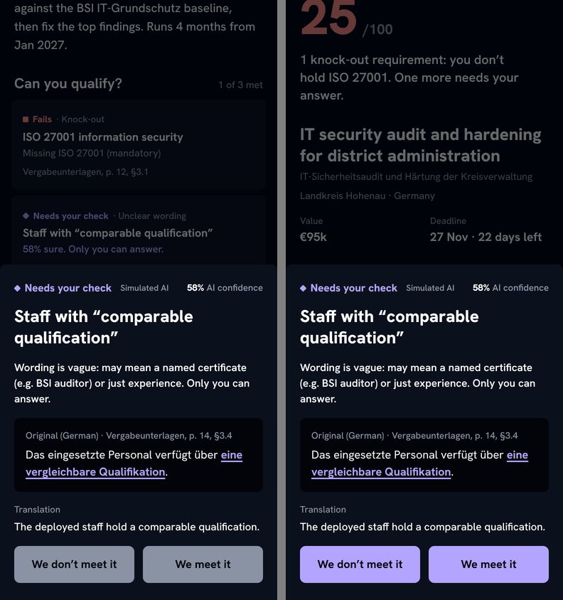
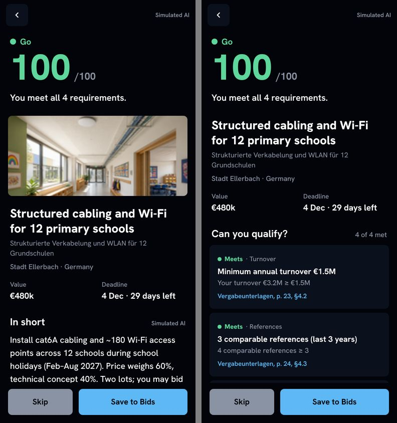
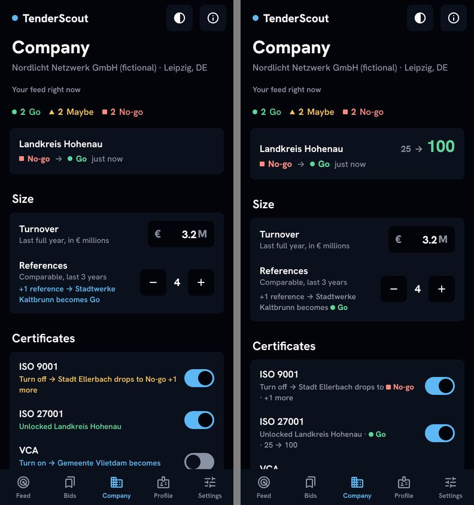

**Vercel: the two repository secrets are still missing, so nothing was deployed.** The manual run on `main` ([42424491332](https://github.com/pioche8/ESCP-2627DT-C1/actions/runs/42424491332)) printed "VERCEL_TOKEN or VERCEL_ORG_ID is not set as a repository secret, so nothing is deployed". The exact steps are under [For you](#for-you), step 2.

**Interview: none to log.** The brief's INTERVIEW NOTES block was empty. The uploaded CSV is the screening form's export, and its one row is S1, already in `evidence.md` §1b. `evidence.md` was not touched, and the respondent's email stayed out of the repository. See [Interview](#interview).

# Pass 5 report, Sun 8 Nov 2026

`git push --force-with-lease origin release/v1-workshop:main` restores the frozen workshop build of the app and the site in one command. `release/v1-workshop` and `backup/*` were not touched, nothing was force-pushed, no tag was pushed and `release/v2-feedback` was not created.

The brief had two parts. Both are merged.
1. **The website** keeps the look of `f6a77af` and has the behaviour of `backup/pre-declutter` again: all 35 effects of the original, in solid shapes and colours ([pioche8/ESCP-2627DT-C1#29](https://github.com/pioche8/ESCP-2627DT-C1/pull/29), ADR-0004). No app byte changed.
2. **The app's UI moved forward before the freeze.** A visual audit of every state (41 states, 198 frames, 7/10) went to a council, which chose three slices on the demo path:
   - S1, demo-path safety ([#30](https://github.com/pioche8/ESCP-2627DT-C1/pull/30));
   - S2, proof first on a tender ([#31](https://github.com/pioche8/ESCP-2627DT-C1/pull/31));
   - S3, the score on the re-score card ([#32](https://github.com/pioche8/ESCP-2627DT-C1/pull/32)).

   Each slice was reviewed adversarially and visually audited before its pull request and merged on green CI, WebKit included. This report's pull request ([#33](https://github.com/pioche8/ESCP-2627DT-C1/pull/33)) re-took the screenshots and the backup recording and brought the documents up to date. It also carries one S3 follow-up fix, which a third verification round found after S3's merge (item 176).

- **App bytes changed (S1–S3 and the follow-up in #33): re-rehearse** `?demo=reset,fast` on the iPhone after the Pages deploy (see [For you](#for-you), step 1). The demo path is still 7 steps. The numbers did not move: Hohenau No-go 25 → Maybe 90 → Go 100, and 1 Go · 2 Maybe · 3 No-go. The backup recording is 51.0 s; before the slices it was 50.7 s.
- **The freeze held.** The last slice (#32) merged at 23:11 London on Sat 7 Nov, and the follow-up merges with #33 in the early hours of Sun 8 Nov, both before the council's Mon 12:00 stop and the Mon 9 Nov 18:00 freeze. Nothing needed the `after-feedback` label.
- **Time:** this session's record starts Sat 7 Nov at 12:12 London; the report was written around midnight, Sat 7 to Sun 8 Nov. The app-byte freeze (Mon 9 Nov, 18:00 London) was never close to binding.

## Interview

- **The INTERVIEW NOTES block of the brief:** empty.
- **The uploaded CSV:** the screening form's export (`CLAUDE.md` §11 item 163). Its one row is S1 (5 Nov; owner or managing director; 5–19 staff; 3–5 tenders read in a year; 1–2 days to decide), already in `evidence.md` §1b without the contact field.
- **What was logged:** nothing. `evidence.md` is unchanged, the gate stays unsigned, and no persona, journey, quote or feedback was written. The 11 Nov pack's question 2 already handles "no logged interview at submission".

## What changed

| Pull request | What | Deployed app bytes |
|---|---|---|
| [#29](https://github.com/pioche8/ESCP-2627DT-C1/pull/29) | The website: the look of `f6a77af`, the 35 effects of the original back in solid shapes and colours, the site's gates back, recordings in `docs/site/` (ADR-0004; items 163–169) | No |
| [#30](https://github.com/pioche8/ESCP-2627DT-C1/pull/30) | App S1, demo-path safety: a toast stays on the screen that raised it, the unresolved answer pair in the ◆ check colour, the Closed score readable (item 171) | **Yes** |
| [#31](https://github.com/pioche8/ESCP-2627DT-C1/pull/31) | App S2, proof first on a tender: the checklist right under the title, the photo at the end, brand citations, a Closed checklist as a record (item 172) | **Yes** |
| [#32](https://github.com/pioche8/ESCP-2627DT-C1/pull/32) | App S3, the score on the re-score card ("25 → 100", counting up), hints with shape + word and the score, the tapped switch kept under the finger (items 173–174) | **Yes** |
| [#33](https://github.com/pioche8/ESCP-2627DT-C1/pull/33) | This report: the `docs/ui` frames and the backup recording re-made, `BRIEF.md` step 5, the 11 Nov pack, README "Live now", `ARCHITECTURE.md`, `docs/START_HERE.md`, `UI_DESIGN.md`, two capture-script fixes, `CLAUDE.md` §0 and items 175–176. **And one app fix in its own commit:** the S3 follow-up of item 176 (a drop just above the tab bar) | **Yes** (the follow-up commit only) |

## Merged

Every pull request was merged with a merge commit on green CI. This branch, `claude/wonderful-sagan-ciqz8e`, was restarted from `main` after each merge (item 168), so each pull request holds only its own commits.

| Pull request | Merge commit | Merged (London) | CI `check` + `smoke` | WebKit iPhone 13 / SE |
|---|---|---|---|---|
| [#29](https://github.com/pioche8/ESCP-2627DT-C1/pull/29) website | `9471e63` | Sat 7 Nov 17:26 | green | clean / clean |
| [#30](https://github.com/pioche8/ESCP-2627DT-C1/pull/30) S1 | `c938814` | Sat 7 Nov 18:59 | green | clean / clean |
| [#31](https://github.com/pioche8/ESCP-2627DT-C1/pull/31) S2 | `d856609` | Sat 7 Nov 20:13 | green | clean / clean |
| [#32](https://github.com/pioche8/ESCP-2627DT-C1/pull/32) S3 | `7856157` | Sat 7 Nov 23:11 | green | first run: iPhone 13 had 8 failing lines (item 174), fixed in `d5721a3`; then clean / clean |
| [#33](https://github.com/pioche8/ESCP-2627DT-C1/pull/33) this report and the S3 follow-up | in the comment on #33 | | | |

No other branch was created or deleted, and no pull request was left open with the `after-feedback` label.

## Website

**What Luca asked for:** the look of `f6a77af` with the behaviour of `backup/pre-declutter`. That means every animation and map feature, working the same way, in the decluttered look.

**What landed:** [pioche8/ESCP-2627DT-C1#29](https://github.com/pioche8/ESCP-2627DT-C1/pull/29), merged as `9471e63` on Sat 7 Nov at 17:26 London. The decision record is [ADR-0004](../adr/0004-website-current-look-original-motion.md), and items 163–169 supersede items 139–142.

**What did not change:** no deployed app byte.

**Recordings** (made by `site/scripts/record.cjs`, because the website is not online):
- [`docs/site/site-1440.mp4`](../site/site-1440.mp4): 31 s at 1440 × 900;
- [`docs/site/site-390.mp4`](../site/site-390.mp4): 26 s at 390 × 844 (2×, touch);
- [`docs/site/before-after.jpg`](../site/before-after.jpg): `main`'s 6 Nov site on the left, this one on the right (the hero, the map, the phone).

### The inventory

The 35 effects of the original, probed in Chromium on the original's static export and on `f6a77af`'s. "Before" is `f6a77af`: **yes** worked, **part** worked in part, **no** missing. Each one now has its original trigger, timing and easing. The check that covers each effect is in ADR-0004's appendix.

| # | Original effect | Before | Now (solid shapes and colours) |
|---|---|---|---|
| 1 | Hero glow drift | no | a surface disc on the same ellipse |
| 2 | Hero glow follows the cursor | no | the disc eases to the cursor |
| 3 | Gradient wordmark lit at the glow | no | letters step ink → brand → muted by distance from the disc |
| 4 | Statement glows drift | no | two surface discs, 16 s / 20 s |
| 5 | Statement word-by-word reveal | yes | unchanged |
| 6 | Hop pill | no | three verdict shapes hop beside plain text |
| 7 | Rolling word | yes | unchanged |
| 8 | Tender card lift | yes | unchanged; the track no longer clips it |
| 9 | "Bid." photo pan | no | one brand letter travels B → i → d → i |
| 10 | Light sweep across the lines | no | one brand word at a time sweeps the sentence |
| 11 | Spotlight dot grid | no | canvas squares lit muted / brand near a mouse pointer |
| 12 | 0 → 777 counter | yes | unchanged |
| 13 | Ring fills with the counter | no | a brand stroke on a ground-coloured track |
| 14 | Orb behind the step visual | no | a surface disc that moves and resizes per step |
| 15 | Step visual crossfade | yes | unchanged |
| 16 | Step bars | no | four bars, lit up to the active step |
| 17 | Inactive steps dimmed | part | muted → ink |
| 18 | Folder card lift | yes | unchanged; the track no longer clips it |
| 19 | Folder panel fold | no | the panel slides 47 % → 58 % |
| 20 | Phone dock pill | no | a brand block slides under the active tab |
| 21 | Phone re-score | yes | unchanged: 25 → 90 → 100 |
| 22 | Radial fill (Save to Bids) | no | an ink circle clipped from the pointer |
| 23 | Wipe (Skip) | no | a brand fill wipes in from the left |
| 24 | Sector strips accordion | no | flex 1 → 2.2 (row) or photo height (phone) |
| 25 | Sector marquee | no | two rows of plain text, paused on hover and off-screen |
| 26 | Map arcs flowing | no | dashed arcs with a ground-coloured casing |
| 27 | Map home pulse | no | a ring that grows and thins |
| 28 | Map pins and tooltips | no | pins and a plain tooltip; hover, tap, Enter to hold, Escape |
| 29 | Map re-score with the engine | part | 1 · 2 · 3 → 1 · 1 · 4, only Valdemora flips; the tiles re-flex and count up |
| 30 | Film ping, zoom, play scale, bar | no | an ink play square, a ring that thins; zoom, scale, bar |
| 31 | Wave fill (header, film, Start) | no | an ink ellipse rises, clipped |
| 32 | FAQ fold | yes | unchanged |
| 33 | Metal ring | no | a thin ring with a travelling sheen |
| 34 | Start glow drift | no | a surface disc on the same drift |
| 35 | Menu slide, link shift and arrow | part | the slide, the shift and the arrow |

Still removed, because they are look, not motion: the grain overlays, the map's graticule, flags and credit, the chapter chips, the glass and the badges.

**Gates now on the website:**
- the site's token files are generated from `shared/tokens.json` again;
- the declutter scan covers the site's three stylesheets and its rendered pages;
- the contrast audit: 52 pairs, 0 failures;
- no mono or italic font files;
- `a11y-motion.cjs`: 90 checks, with motion, under reduced motion, by keyboard and by touch;
- Lighthouse 99 in performance (97–99 on a rerun alone) and 100 in the other three categories;
- axe: 0 violations, including on each phone tab, the open menu and an open map tooltip.

**Audits, every finding fixed** (item 169):
- `/agentic-council:visual-audit`: 6/10 at the start, 18 findings;
- an adversarial review workflow: 26 findings, 3 of them refuted.

## App UI

**How the slices were chosen** (items 170 and 174; the record is [`2026-11-07-pass-5-council.md`](2026-11-07-pass-5-council.md)):
- **Visual audit:** `/agentic-council:visual-audit` looked at every state in `SKELETON.md`, 41 states (49 views with the full-page and scrolled ones; one state in dark only) in dark and light at 390 × 844 and 320 × 568, plus 4 smoke-test frames: 198 frames, and scored the app 7/10. The declutter rules hold on every screen. The weak spots were all on the demo path.
- **Council:** four members (Strategist, Advocate, Artisan, Skeptic), one round in quick mode, with the Steward's synthesis. It chose three slices to be merged in order, the last by Mon 12:00 London (the Skeptic's stop). It cut a standalone motion slice, the Feed's hierarchy and the finished states, which are candidates after the 11 Nov call.
- **Navigation check:** `/agentic-council:navigation-design` ran before any slice touched the demo path. The 13 routes, the five tabs, sheets as history entries, deep links, Back and Escape, and the stored state are all unchanged, and the path stays at 7 steps.
- **Per slice:** its own branch state and pull request; the preflight (15 gates before the smoke test, 14 in node and `tests.html` in Chromium, then the smoke test at 390 × 844, iPhone 13 and iPhone SE, each in dark, light and reduced motion) and the site check; an adversarial review and a visual audit before the pull request, every finding put to two refuters; then CI (`check`, `smoke`) and WebKit on both iPhones on GitHub's runners, and the merge. Each carries the `re-rehearse` label.

Each image below is the frame before the slice (from `main` at `9471e63`, the app of 6 Nov) on the left, and the frame now on the right. All are 390 × 844, dark.

### S1, demo-path safety ([#30](https://github.com/pioche8/ESCP-2627DT-C1/pull/30), merged `c938814`, 18:59)



- **A toast belongs to the screen that raised it.** Leaving the screen removes it, and a sheet removes the toast behind it. Before, in step 5, the step-4 toast "Answer saved · now No-go · Undo" was still on Company, with Undo under the ISO 27001 switch: a mis-tap removed the answer and the flip honestly showed No-go → Maybe.
- **The unresolved answer pair** is filled in the ◆ check colour at equal width (right). Before, it was grey and looked disabled (left).
- **The Closed score "0"** is bg on muted: 5.36:1 in light mode, where it was 2.90:1.
- **Reviews:** S1's visual audit scored 8–9 and confirmed no finding; four were refuted.

### S2, proof first on a tender ([#31](https://github.com/pioche8/ESCP-2627DT-C1/pull/31), merged `d856609`, 20:13)



- **The order is now:** the verdict header, the title and facts, "Can you qualify?" (knock-outs first), In short, Ask this tender, Competition, then the photo. At 390 × 844 the first requirement is on screen without a scroll on Ellerbach and Hohenau; before, it started at 812–863 px, below the 764 px action bar.
- **Citations are brand text** (muted on a ◆ line and on a Closed tender, so each card has one brand element). "Closed" appears once, and a Closed tender's checklist is a record.
- **Reviews:** the slice's visual audit confirmed four minor findings, all fixed before the pull request (item 172).

### S3, the score on the re-score card ([#32](https://github.com/pioche8/ESCP-2627DT-C1/pull/32), merged `7856157`, 23:11)



- **The card shows "25 → 100"** from `Engine.diff`, in the new verdict's colour. The score starts counting 315 ms into the existing 700 ms morph and counts for 650 ms; when the card pops it counts at once, and under reduced motion it is set at once.
- **The hints are muted text with the verdict as shape + word.** Once a switch moves a tender up, its hint carries the score too ("Unlocked Landkreis Hohenau · ● Go · 25 → 100"), so on the iPhone SE, where the card and the switch never fit on one screen, the payoff is seen at the switch. Each language has its own hint, and no line ends on "→", "·" or "+1".
- **The switch just tapped does not jump** when its hint gains a line or the card above it changes height, and the neutral card and the score card are one height. The card comes back into view only when that keeps the switch in view (an instant scroll, which does move the switch, as since 4 Nov).
- **Reviews:** S3 took four rounds after its visual audit (7–8.5; one major finding and three minor ones):
  - two verification workflows (16 agents each);
  - a third round on round 3's changes (two hunters, each finding put to two refuters; 8 agents). It confirmed one regression, fixed in #33 as an S3 follow-up (item 176): turning a lever off just above the tab bar left its hint under the tab bar, and on the iPhone SE without scroll anchoring the switch too;
  - WebKit on this pull request's first run, which found the last case: a hint gaining a line re-centred the switch 10 px lower, and Safari has no scroll anchoring to undo it.

  Each fix has a smoke check that fails on the code before it (item 174).

**After the last slice** (#33, items 175–176):
- every `docs/ui` frame was re-taken;
- `node tests/demo-record.js` re-made the backup recording: 51.0 s against 50.7 s before the slices, inside the brief's 3 s;
- `SKELETON.md`, `docs/NAVIGATION.md` and `UI_DESIGN.md` were checked against the merged app (each slice had already updated its own wireframe and flow).

## Live now

| Link | What | Proof |
|---|---|---|
| https://pioche8.github.io/ESCP-2627DT-C1/?demo=reset,fast | **The demo link** (BRIEF.md's 75-second path, Hohenau No-go 25 → Maybe 90 → Go 100), with all three slices | On `7856157` (#32's merge): Pages run [42424127882](https://github.com/pioche8/ESCP-2627DT-C1/actions/runs/42424127882) deployed at 23:12 London; post-deploy run [42424166014](https://github.com/pioche8/ESCP-2627DT-C1/actions/runs/42424166014): every served file identical to `main`, and the smoke test passed against the live URL |
| https://pioche8.github.io/ESCP-2627DT-C1/ | The same app, keeping your state | the same runs |
| The website | **Not online.** The Vercel workflow deploys nothing until the two secrets exist; [`docs/site/`](../site/) has recordings | Manual run [42424491332](https://github.com/pioche8/ESCP-2627DT-C1/actions/runs/42424491332) on `main` (`7856157`): `plan` printed the missing-secrets notice; the site, app, preview and live jobs were skipped |
| Vercel app | **Not online**, for the same reason | the same run |

Every merge of this pass deployed and passed its live check:

| Merge | Pages run | Post-deploy run (live-check + live smoke) |
|---|---|---|
| `9471e63` (#29, website) | [42396358315](https://github.com/pioche8/ESCP-2627DT-C1/actions/runs/42396358315) | [42396395315](https://github.com/pioche8/ESCP-2627DT-C1/actions/runs/42396395315) |
| `c938814` (#30, S1) | [42404020025](https://github.com/pioche8/ESCP-2627DT-C1/actions/runs/42404020025) | [42404061091](https://github.com/pioche8/ESCP-2627DT-C1/actions/runs/42404061091) |
| `d856609` (#31, S2) | [42410030715](https://github.com/pioche8/ESCP-2627DT-C1/actions/runs/42410030715) | [42410061039](https://github.com/pioche8/ESCP-2627DT-C1/actions/runs/42410061039) |
| `7856157` (#32, S3) | [42424127882](https://github.com/pioche8/ESCP-2627DT-C1/actions/runs/42424127882) | [42424166014](https://github.com/pioche8/ESCP-2627DT-C1/actions/runs/42424166014) |
| #33's merge (this report) | in the comment on #33 | in the comment on #33 |

**How this was verified.** This container cannot open github.io, so the proof is the Actions API: the "pages build and deployment" run, then the `post-deploy` run on GitHub's runner, which compares every served file with `main` byte for byte (`tests/live-check.js`) and runs the smoke test against the live URL. That smoke test is Chromium; Mobile Safari is tested only by your rehearsal.

## Verification per gate

The preflight ran on each slice's branch before its pull request, and again on this report's final tree. WebKit cannot be installed in this container, so the iPhone rows here are Chromium emulation; WebKit ran on GitHub's runners (`webkit.yml`) on every pull request and every merge.

| Gate | On each slice (#30, #31, #32) | On this report's final tree |
|---|---|---|
| `node tests/preflight.js --no-site`: the 15 gates before the smoke test, 14 in node (engine 24, insights, data, docs, demo pins, invariants, no live AI, declutter scan, WCAG AA 52 pairs, generated tokens and decision model, the site's copies, Vercel dist, section owner) and `tests.html` over `file://` and HTTP in Chromium | ok | ok |
| `node tests/smoke.js` 390×844, `SMOKE_DEVICE="iPhone 13"`, `"iPhone SE"` (dark, light, reduced motion, 0 console errors) | ok on all three | ok on all three in the final preflight, with the S3 follow-up (0 console errors). Before that, on the documents-only tree, 390×844 crashed twice, then passed alone. Both crashes were 30 s selector timeouts at different steps ("feed-closed"; then "morning-notification" and "injected error"), while round 3's sweeps ran 16 browser workers (load average 6.6–8.7 on 4 CPUs). It was not retried away (item 149) |
| `cd site && npm run check` | ok | ok |
| `cd site && npm run audit` (Lighthouse, axe) | ran on #29: Lighthouse 99 in performance (97–99 on a rerun alone) and 100 in the other three categories, axe 0 | not re-run: no site source changed since #29; only the generated decision model's smoke-check count, which the `/how` page shows, moved |
| CI `check` and `smoke` | green on #29–#32 and on every merge | green before the merge (the merge waits for them) |
| WebKit iPhone 13 and iPhone SE (informational) | clean on #29, #30, #31. On #32's first run the iPhone 13 had 8 failing lines (item 174); after the fix both are clean on #32 and on its merge | on #33 |
| Relative links and anchors in the Markdown this pass changed | — | 0 broken in the 21 Markdown files pass 5 changed |
| Pages + post-deploy | see [Live now](#live-now) | in the comment on #33 |

## Decisions taken alone

All are in `CLAUDE.md` §11, items 163–176.
- **163:** the CSV is the screening form's export (S1), not interview notes; `evidence.md` untouched, the email kept out.
- **164–167:** the website. The look of `f6a77af` with the behaviour of `backup/pre-declutter`; every effect that is a glow, gradient, pill, alpha fade or mono text plays in solid shapes and colours (ADR-0004's appendix lists each one, so Luca can ask for an exception per effect). The gates are back on the site, and the proof is a recording because the site is not online.
- **168:** one branch at a time, because the session can push only to its own branch: a pull request per slice, then the branch restarts from `main`.
- **169:** the website's two audits, every finding fixed.
- **170:** the slices come from a council on a visual audit; three, not five, with a Monday 12:00 stop.
- **171–173:** the three slices.
- **174:** the reviews and what they changed, including what was left as it is (see [Caveats](#caveats)).
- **175:** the frames, the recording and the documents after the last slice.
- **176:** the S3 follow-up found by the third verification round, carried in this report's pull request as its own commit.

## For you

1. **Rehearse on the iPhone (Tuesday 10 Nov).** App bytes changed in S1–S3. Open https://pioche8.github.io/ESCP-2627DT-C1/?demo=reset,fast in Safari and follow the pack's checklist ([`docs/feedback/2026-11-11.md`](../feedback/2026-11-11.md)). Step 5 now shows "25 → 100" counting up on the card. Then cut the freeze point yourself:
   ```bash
   git push origin origin/main:refs/heads/release/v2-feedback
   ```
2. **Vercel** (about five minutes; the clicks are in [`docs/DEPLOY.md` §0](../DEPLOY.md#0-what-you-do-about-five-minutes-once)):
   1. Create a token at vercel.com/account/settings/tokens, with Scope Sponso.
   2. Copy Sponso's Team ID (Settings → General).
   3. Add both as repository secrets:
      ```bash
      gh secret set VERCEL_TOKEN --repo pioche8/ESCP-2627DT-C1
      ```
      ```bash
      gh secret set VERCEL_ORG_ID --repo pioche8/ESCP-2627DT-C1
      ```
   4. Run the workflow:
      ```bash
      gh workflow run vercel.yml --repo pioche8/ESCP-2627DT-C1 --ref main
      ```
   5. If the deploy job says HTTP 403, use a personal-scope token and your Vercel ID instead, and run it again. Do not re-import the repository through the Vercel dashboard (ADR-0003).
3. **Paste the interview notes** when you have them, and run the next pass with them in the INTERVIEW NOTES block (pass 4's report, "For you" step 1, says what to include and what to leave out).
4. **Delete this pass's branch** once #33 is merged (it is then fully merged):
   ```bash
   git push origin --delete claude/wonderful-sagan-ciqz8e
   ```
   Pass 4's [delete commands](2026-11-07-pass-4.md#delete-commands) for the older branches still apply.
5. **Still open from pass 4:** the `v1-workshop` tag, the repository's About box, the `main` ruleset and the team names (the commands are in [pass 4's "For you"](2026-11-07-pass-4.md#for-you), step 5).

## Caveats

- **Real Safari is tested only by your rehearsal.** WebKit on GitHub's runners is the engine, not Mobile Safari: no standalone mode, no real safe-area insets, no touch hardware.
- **The interview is still the missing piece.** `evidence.md` logs 0 interviews and 1 survey answer; the gate is unsigned.
- **Left as they are in the app** (item 174):
  - The bring-back scroll (since 4 Nov) and the hint lift on a short phone move the switch under the finger, so a quick second tap in the same place can miss it. Since round 3 the bring-back also runs when only the score row is cut off (a scroll of 28–98 px at 390 px); round 3's refuters judged that the same trade-off, 2 of 2.
  - On the iPhone SE a drop's new score is only on the card above; its hint says how to undo it.
  - The "Restored to Deciding" toast can cover the next Restore on Bids for 4 s.
  - On Hohenau at 390 × 844 the ◆ line's "Check →" sits under the action bar at load (the line runs 654–827 px, the bar starts at 764 px). The rest of the line is on screen, and the whole line is the link.
  - On a Closed tender (test-only `?today=`) the ◆ line still reads "Only you can answer." and its sheet still takes an answer.
- **The S3 follow-up (item 176) was tested in Chromium,** with scroll anchoring switched off as a stand-in for Safari, and in WebKit on GitHub's runners. Like everything else here, it has not been tried on a real iPhone.
- **The website is not online,** so its Lighthouse and axe results come from a static export in this container (#29), not from a Vercel URL.
- **`check.yml` still uses `@v4` action tags** (the Node 20 warning on every run), and the `main` ruleset is still not applied (item 92). This pass merged on green CI by convention.

## Rollback

- **Everything:** `git push --force-with-lease origin release/v1-workshop:main` restores the frozen workshop build. It would undo everything since 4 Nov, so it is the emergency command only.
- **One slice:** revert its merge commit (GitHub → the pull request → Revert): S3 `7856157`, S2 `d856609`, S1 `c938814`, the website `9471e63`. The S3 follow-up alone: `git revert` its commit in #33 (`App S3 follow-up: …`), in a pull request. Revert S3 before S2 and S2 before S1, because each slice's smoke checks build on the one before. Each revert goes through CI as its own pull request.
- **After Tuesday:** `release/v2-feedback` is the freeze point for 11 Nov, once you have cut it.
